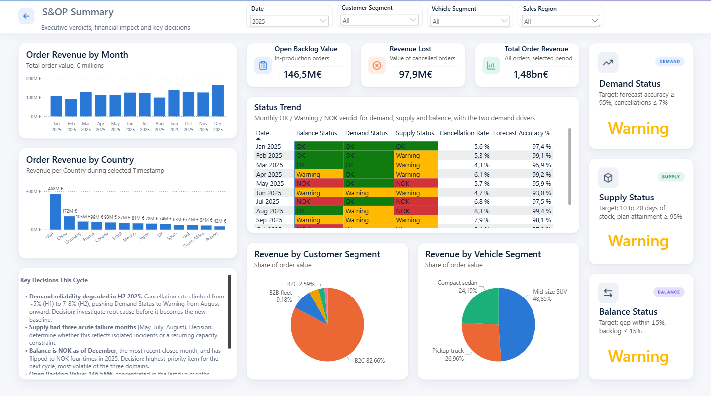
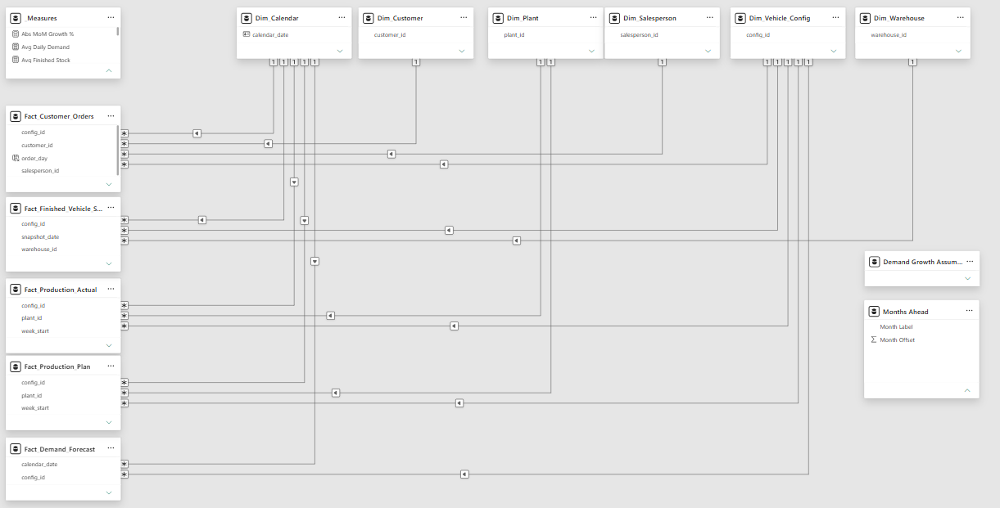
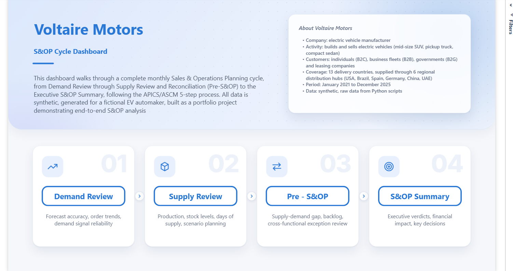
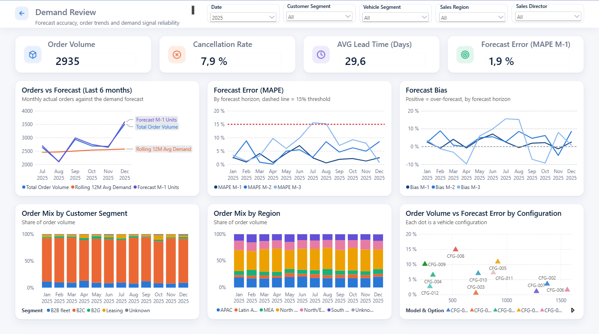
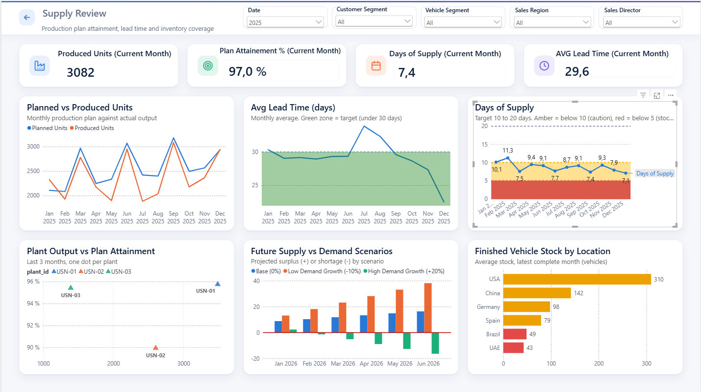
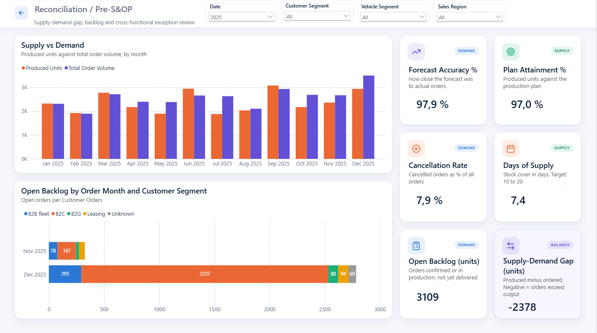

# Voltaire Motors - S&OP Monitoring Dashboard

An end-to-end Sales & Operations Planning project for a fictional electric vehicle manufacturer: synthetic but realistic data generation, a three-layer Python data pipeline, a star-schema data model, and a five-page Power BI dashboard that walks through a complete monthly S&OP cycle.

Built as a portfolio project to show how an S&OP team turns scattered operational data into one version of the truth, clear exceptions, and decisions, following the APICS/ASCM S&OP process.




## Business context

Voltaire Motors (fictional) builds three vehicle segments (mid-size SUV, pickup truck, compact sedan) in three plants and sells them in 13 countries through 6 regional hubs (USA, Brazil, Spain, Germany, China, UAE), to private buyers, fleets, governments and leasing companies.

Growth has outpaced its planning process:

- Sales, production and logistics work in silos, each with its own numbers
- Forecasts and production plans are misaligned, so supply is either short or piling up
- The monthly planning meeting is reactive firefighting instead of decision-making

This project builds the tool the S&OP team needs to run a structured monthly cycle: is demand reliable, can supply follow, where do they disagree, and what do we decide.


## Key results (2025)

| Metric | Result |
|---|---|
| Total order revenue | €1.48bn |
| Open backlog value (confirmed and in production) | €146.5M |
| Revenue lost to cancellations | €97.9M |
| Cancellation rate, H1 vs H2 | about 5% vs 7 to 8% |
| Months with Supply status NOK | 3 (May, July, August) |
| Months with Balance status NOK | 4, including December |
| Days of supply | mostly 7 to 11 days, below the 10-day comfort level |

Headline insight: the problem is not one function failing, it is the gap between them. Demand reliability degraded in the second half of the year (rising cancellations), supply struggled to hold stock cover, and the balance between the two broke down four times. That is exactly the situation a monthly S&OP cycle is designed to catch early.


## Recommended actions (S&OP cycle, December 2025)

What I would bring to the executive S&OP meeting, based on the dashboard:

1. **Treat cancellations as a demand problem, not noise.** The cancellation rate moved from about 5% in H1 to 7 to 8% in H2, from July onward, the month of the ERP migration. Decision: run a root-cause review with Sales and Customer Service (for example order entry errors after the migration, or delivery dates promised vs achieved) before 8% becomes the accepted baseline.

2. **Rebuild stock cover before demand picks up.** Days of supply sat between 7 and 11 days for most of the year, under the 10-day comfort level, and Brazil and the UAE hold the thinnest stock. Decision: raise the production plan or rebalance hub stock so every hub is back above 10 days, starting with the two most exposed.

3. **Make the balance the first agenda item.** Balance was NOK four times in 2025, including December. Decision: open each S&OP meeting with the supply-demand gap, and agree an explicit trade-off each month (build ahead, prioritise segments, or accept a longer lead time), instead of letting the gap resolve itself.

4. **Protect the backlog.** €146.5M of open orders is concentrated in the last two months, mostly B2C. Decision: confirm delivery dates for the oldest open orders first, to stop the backlog turning into the next wave of cancellations.


## Project structure

| Layer | What it does |
|---|---|
| Raw | Generates the synthetic data as if exported from source systems (CRM orders, ERP production plan and actuals, WMS stock) over 2021 to 2025, with realistic patterns baked in: seasonality, a 2021 component shortage, cancellations, lead-time drift and an ERP migration in July 2025. Data quality defects are injected on purpose, as in real exports |
| Staging | Fixes every injected defect, types and standardises each table |
| Curated | Validates and publishes: cross-table reconciliation (production vs deliveries), status and date consistency, plant and model compatibility |
| Data model | Star schema in Power BI: 5 fact tables and 6 dimensions, plus two parameter tables for the demand scenarios |
| Dashboard | 5-page Power BI report mirroring the S&OP cycle |

Each table follows the same three-script pattern (raw, staging, curated), so every dataset that reaches Power BI has been cleaned and validated the same way.

| Facts | Dimensions |
|---|---|
| Customer Orders, Demand Forecast, Production Plan, Production Actual, Finished Vehicle Stock | Calendar, Customer, Vehicle Configuration, Plant, Warehouse, Salesperson |




## Dashboard

Built in Power BI. One page per S&OP step, plus a landing page.

1. Overview - what the report covers and navigation to each step

2. Demand Review - forecast vs orders, forecast error (MAPE) and bias by horizon (M-1, M-2, M-3), order mix, and forecast error by vehicle configuration

3. Supply Review - plan vs actual production, lead time against target, days of supply against a three-zone target band, plant performance, demand scenarios (-10% / +20%), and stock by location

4. Reconciliation / Pre-S&OP - supply vs demand by month, open backlog by customer segment, and a paired scorecard (demand side, supply side, balance)

5. S&OP Summary - financial impact, one status per pillar (OK / Warning / NOK), the monthly status history, and the key decisions for the cycle







## Methodology notes

- Dirty data on purpose: the Raw layer deliberately contains the defects found in real system exports (duplicates, inconsistent formats, invalid values). Each one is listed in [`scripts/data_quality_issues.md`](scripts/data_quality_issues.md), fixed in Staging and checked with assertions in Curated, so the dashboard is built on data that has been proven clean, not assumed clean.

- Explicit status logic: each pillar gets a monthly verdict computed in DAX, with thresholds written down so every colour can be explained.

| Pillar | OK | NOK | Otherwise |
|---|---|---|---|
| Demand | Forecast accuracy ≥ 95% and cancellation rate ≤ 7% | Accuracy < 90% or cancellations > 10% | Warning |
| Supply | Days of supply between 10 and 20 and plan attainment ≥ 95% | Days of supply < 5 or > 30, or attainment < 85% | Warning |
| Balance | Supply-demand gap within ±5% and backlog ≤ 15% of order revenue | Gap beyond ±15% or backlog > 30% | Warning |

- Thresholds calibrated on the data, not picked arbitrarily: the first cancellation ceiling (5%) sat below this business's normal range (4 to 8%), so Demand showed Warning 11 months out of 12 and the status meant nothing. It was recalibrated so the status flags real deviations, not normal noise.

- Latest closed month vs selected period: KPI cards marked "Current Month" are pinned to the last complete month, while trend charts follow the date slicer. Mixing the two silently is a classic source of contradictory numbers in S&OP packs, so the pinned measures are built and named separately ("Current Month").

- Historical benchmarks for targets: targets such as the 30-day lead time were set from 2024 to 2025 history (median and 75th percentile) rather than from an assumed value.

- Design as part of the analysis: one grid and one colour system across all pages, with status colours (green, amber, red) reserved for verdicts and never used for data series, so a red mark always means a problem.


## Tech stack

- Python 3.11 (pandas, numpy) for data generation and the three-layer pipeline
- Power BI Desktop and DAX for the data model, measures, status logic and dashboard
- Custom Power BI theme (JSON) and page backgrounds for a consistent design


## Repository structure

```
voltaire-motors-sop-dashboard/
├── dashboard/      # .pbix file and Power BI theme
├── data_/          # curated tables (CSV), the pipeline's final output
├── Screenshots/    # dashboard screenshots used in this README
├── scripts/        # Python pipeline (raw, staging, curated) and config.py
├── requirements.txt
└── README.md
```


## How to run it

**Open the dashboard (no install needed beyond Power BI):** download `dashboard/Voltaire_SOP_cycle.pbix` and open it with Power BI Desktop (free, Windows). The data is already inside the file. Start on the Overview page and use the buttons to navigate; the back arrow on each page returns to the Overview.

**Explore the data without Power BI:** the final tables are in `data_/` as CSV files, readable in Excel, Python or any BI tool.

**Rebuild the data from scratch (Python 3.11):**

```bash
pip install -r requirements.txt
cd scripts

# 1. Raw: generate the source-system exports (with deliberate defects)
python raw_generate_calendar.py
python raw_generate_dimensions.py
python raw_generate_facts.py

# 2. Staging: clean every table (dimensions first, orders need customers)
python staging_clean_calendar.py
python staging_clean_customer.py
python staging_clean_salesperson.py
python staging_clean_plant.py
python staging_clean_warehouse.py
python staging_clean_vehicle_config.py
python staging_clean_orders.py
python staging_clean_production_plan.py
python staging_clean_production_actual.py
python staging_clean_finished_stock.py

# 3. Curated: validate and publish (dimensions first, facts check against them)
python curated_publish_calendar.py
python curated_publish_customer.py
python curated_publish_salesperson.py
python curated_publish_plant.py
python curated_publish_warehouse.py
python curated_publish_vehicle_config.py
python curated_publish_orders.py
python curated_publish_production_plan.py
python curated_publish_production_actual.py
python curated_publish_finished_stock.py

# 4. Cross-table checks (production vs deliveries, statuses, plant/model compatibility)
python verify_wave1_integration.py
```

The scripts write to a local `data/` folder (raw, staging, curated). With `RANDOM_SEED = 42` in `config.py`, every run produces exactly the same data, and the expected row counts are listed in `scripts/data_quality_issues.md`.


## About

Built by Aboubacar Diaby - S&OP Manager & Supply Chain Specialist, APICS CPIM certified.

[LinkedIn](https://www.linkedin.com/in/aboubacar-diaby-3b3a1b180/)

[LinkedIn](https://www.linkedin.com/in/aboubacar-diaby-3b3a1b180/)
